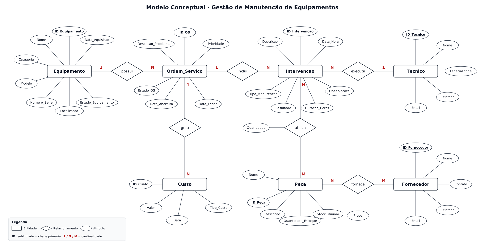
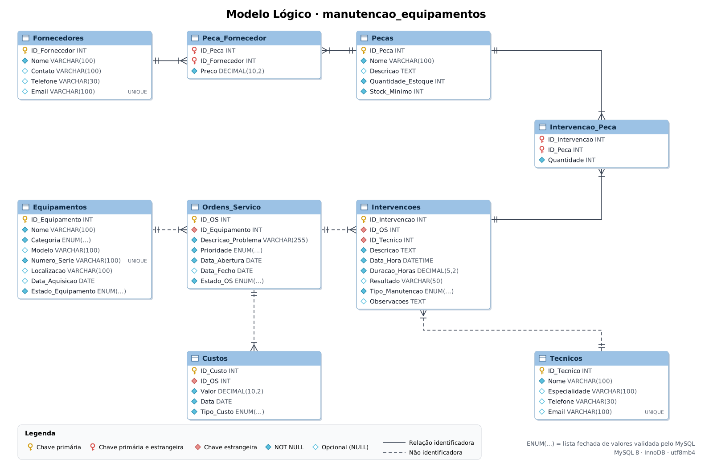

# Gestão de Manutenção de Equipamentos de Telecomunicações · SQL

Base de dados relacional em **MySQL** para gerir a manutenção dos equipamentos de rede de uma operadora de telecomunicações: ordens de serviço, intervenções dos técnicos, consumo de peças, fornecedores e custos.

O projecto cobre o ciclo completo: **modelação → regras de integridade → dados → lógica de negócio na base de dados → análise com SQL avançado**.

---

## O problema

A equipa técnica precisa de responder a perguntas como:

- Que equipamentos avariam mais, e quais nos custam mais dinheiro?
- Quanto tempo demoramos, em média, a reparar uma avaria?
- Que técnicos estão sobrecarregados?
- Que peças vão faltar em breve, e a que fornecedor as devemos comprar?
- Estamos a fazer manutenção preventiva suficiente, ou só a apagar fogos?

Sem um sistema estruturado, estas respostas ficam espalhadas por folhas de cálculo e e-mails.

---

## Modelo de dados

### Modelo conceptual (notação de Chen)



### Modelo lógico (MySQL)



**Decisões de modelação**

- **Valores fixos em `ENUM`** (estado da OS, prioridade, tipo de manutenção, tipo de custo, categoria), em vez de tabelas auxiliares, porque são listas curtas e estáveis e o MySQL valida-as directamente.
- **Duas relações N:N** resolvidas com tabelas associativas que guardam atributos próprios: o *preço* depende do par peça–fornecedor e a *quantidade* depende do par intervenção–peça.
- **OS e Intervenção são entidades separadas**: uma avaria pode exigir várias visitas, de técnicos diferentes (ex.: diagnóstico e depois reparação).
- **Integridade garantida na base de dados**, não apenas na aplicação:
  - `CHECK` impede datas de fecho anteriores à abertura, OS concluídas sem data de fecho, valores e quantidades negativos;
  - `UNIQUE` impede números de série e e-mails duplicados;
  - `ENUM` restringe estados, prioridades, categorias e tipos de custo a valores válidos.
- **Índices** nas colunas usadas em filtros dos relatórios (estado da OS, datas, tipo de manutenção). As chaves estrangeiras já são indexadas automaticamente pelo InnoDB.

---

## Dados

Dados fictícios, mas **coerentes entre si**, que cobrem o ano de 2024:

| Tabela | Registos |
|---|---:|
| Equipamentos | 15 |
| Técnicos | 10 |
| Peças | 13 |
| Fornecedores | 10 |
| Peça × Fornecedor | 30 |
| Ordens de Serviço | 57 |
| Intervenções | 60 |
| Intervenção × Peça | 51 |
| Custos | 109 |

As regras de coerência são:

- as intervenções acontecem dentro do período de cada OS;
- o custo de mão de obra corresponde às horas registadas × 25,00/hora;
- o custo de material corresponde às peças consumidas × preço do fornecedor mais barato;
- os equipamentos em locais exteriores geram custo de deslocação.

---

## Estrutura do repositório

```
docs/
├── diagrama_conceptual.png                Modelo entidade-relacionamento
└── diagrama_logico.png                    Tabelas, tipos e chaves
sql/
├── 01_criacao_base_dados.sql              Tabelas, chaves, CHECK, UNIQUE, índices
├── 02_insercao_dados.sql                  Dados de 2024
├── 03_views_funcoes_procedures_triggers.sql  Lógica de negócio
├── 04_consultas_basicas.sql               10 consultas: JOIN, subconsultas, agregação
├── 05_consultas_avancadas.sql             12 consultas analíticas: CTE e funções de janela
└── 06_demonstracao.sql                    Demonstração de procedures e triggers (com ROLLBACK)
```

---

## Como executar

O projecto foi desenvolvido e executado com:

- **MySQL 8.0** num contentor **Docker**, num servidor **Ubuntu**;
- **DBeaver** como cliente SQL para criar a base de dados e correr os scripts.

É necessário MySQL 8.0.16 ou superior, a primeira versão que aplica as `CHECK` constraints.

### 1. Arrancar o MySQL em Docker (servidor Ubuntu)

```bash
docker run -d \
  --name mysql-manutencao \
  -e MYSQL_ROOT_PASSWORD='escolha_uma_password' \
  -p 3306:3306 \
  -v mysql_manutencao_dados:/var/lib/mysql \
  --restart unless-stopped \
  mysql:8.0
```

O volume `mysql_manutencao_dados` guarda os dados fora do contentor, por isso a base de dados sobrevive a reinícios e actualizações da imagem.

Para confirmar que o servidor está pronto:

```bash
docker ps
docker logs mysql-manutencao | grep "ready for connections"
```

### 2. Ligar o DBeaver ao MySQL

Em **Database → New Database Connection → MySQL**, preencher:

| Campo | Valor |
|---|---|
| Server Host | IP do servidor Ubuntu (ou `localhost` se o DBeaver estiver no próprio servidor) |
| Port | `3306` |
| Username | `root` |
| Password | a password definida em `MYSQL_ROOT_PASSWORD` |

No separador **Driver properties**, definir `allowPublicKeyRetrieval = true`. Sem isto, o MySQL 8 recusa a ligação com o erro *"Public Key Retrieval is not allowed"*.

Se a porta 3306 não estiver aberta na firewall do servidor, há duas alternativas:
- usar o separador **SSH** do DBeaver para ligar através de um túnel (a opção mais segura);
- abrir a porta com `sudo ufw allow 3306/tcp`.

### 3. Executar os scripts no DBeaver

Abrir cada ficheiro da pasta `sql/` pela ordem numérica (**File → Open File**), associá-lo à ligação MySQL e executar o ficheiro inteiro com **Execute SQL Script** (`Alt + X`). Não usar `Ctrl + Enter`, que executa apenas a instrução onde está o cursor.

| Ordem | Script | Resultado |
|---|---|---|
| 1 | `01_criacao_base_dados.sql` | Cria a base `manutencao_equipamentos` e as 9 tabelas |
| 2 | `02_insercao_dados.sql` | Carrega os dados de 2024 |
| 3 | `03_views_funcoes_procedures_triggers.sql` | Cria views, funções, procedures e triggers |
| 4 | `04_consultas_basicas.sql` | 10 consultas, cada uma num separador de resultados |
| 5 | `05_consultas_avancadas.sql` | 12 consultas analíticas |
| 6 | `06_demonstracao.sql` | Demonstração das procedures e triggers |

O script `06_demonstracao.sql` corre dentro de uma transacção com `ROLLBACK`, por isso pode ser executado várias vezes sem alterar os dados. Os testes de regras de negócio no fim desse ficheiro estão comentados. Para os experimentar, retirar o `--` de um deles e executá-lo sozinho com `Ctrl + Enter`.

Depois de executar os scripts, carregar em **F5** sobre a ligação no *Database Navigator* para ver as tabelas, views, procedures e triggers. Com o botão direito sobre a base de dados, a opção **View Diagram** gera o diagrama das tabelas.

### Alternativa: executar pela linha de comandos do servidor

A partir da pasta do projecto, no servidor Ubuntu:

```bash
for f in sql/0[1-3]_*.sql; do
  docker exec -i mysql-manutencao mysql -uroot -p'escolha_uma_password' < "$f"
done

docker exec -i mysql-manutencao mysql -uroot -p'escolha_uma_password' -t < sql/05_consultas_avancadas.sql
```

---

## Lógica de negócio na base de dados

| Objecto | Tipo | O que faz |
|---|---|---|
| `vw_os_detalhe` | View | Uma linha por OS com equipamento, dias de resolução, horas e custo total. É a base para o Power BI. |
| `vw_custos_por_equipamento` | View | Custo por equipamento, separado em mão de obra, material e outros |
| `vw_stock_critico` | View | Peças abaixo do stock mínimo, com o fornecedor mais barato |
| `vw_produtividade_tecnicos` | View | Intervenções, horas e correctivas por técnico |
| `fn_custo_total_os` | Função | Custo total de uma OS |
| `fn_preco_minimo_peca` | Função | Melhor preço disponível para uma peça |
| `sp_abrir_os` | Procedure | Abre uma OS e marca o equipamento como avariado se a prioridade for Alta ou Crítica |
| `sp_fechar_os` | Procedure | Fecha uma OS com validações. Recusa OS inexistentes, já encerradas ou sem intervenções, e repõe o equipamento como operacional. |
| `sp_historico_equipamento` | Procedure | Ficha de manutenção de um equipamento |
| `trg_ip_valida_stock` | Trigger | Bloqueia o consumo de peças sem stock suficiente |
| `trg_ip_abate_stock` | Trigger | Desconta automaticamente do stock as peças usadas |
| `trg_ip_repoe_stock` | Trigger | Repõe o stock quando um lançamento de peças é apagado |

---

## Técnicas SQL utilizadas

| Técnica | Onde |
|---|---|
| `INNER` / `LEFT JOIN` em várias tabelas | 04 · Q4, Q6 · views |
| Subconsultas escalares, correlacionadas, `NOT EXISTS` | 04 · Q3, Q5, Q10 · `vw_stock_critico` |
| `GROUP BY` / `HAVING` / agregação condicional (`CASE`) | 04 · Q8 · `vw_custos_por_equipamento` |
| CTEs (`WITH`) | 05 · A3, A5, A6, A7, A9, A10, A12 |
| `RANK`, `DENSE_RANK`, `ROW_NUMBER` | 05 · A2, A9, A12 |
| `LAG` (comparação com a linha anterior) | 05 · A3, A5, A6 |
| Somas acumuladas e percentagens do total (`SUM() OVER`) | 05 · A2, A3, A7, A8 |
| Views, funções, stored procedures, triggers, `SIGNAL` | 03 |
| Transacções (`START TRANSACTION` / `ROLLBACK`) | 06 |

---

## Principais conclusões (dados de 2024)

**Visão geral:** 57 ordens de serviço, 91,2% concluídas e 3,35 dias de tempo médio de resolução. O custo total foi de **7 877,40**.

1. **A OLT Principal é o equipamento menos fiável.** Avaria, em média, a cada **17 dias** (MTBF), e teve 3 avarias repetidas em menos de 30 dias. O padrão de reincidência sugere que as reparações tratam o sintoma e não a causa. Justifica uma análise de causa raiz. *(A5, A6)*

2. **Avariar muito não é o mesmo que custar muito.** O Servidor e a Firewall concentram **33,6% do custo total**, sobretudo por recurso a serviços externos, enquanto a OLT Principal, que avaria mais, fica em 7.º lugar. 7 dos 13 equipamentos com custos representam 80% do gasto. *(A7)*

3. **Há risco de ruptura nas baterias da UPS.** Há 4 unidades em stock, abaixo do mínimo de 8. Ao ritmo de 2024, o stock cobre apenas **1,4 meses**. O fornecedor mais barato é a TelecomParts, cerca de 15% abaixo do mais caro. *(A10, A9, `vw_stock_critico`)*

4. **A manutenção é sobretudo reactiva.** A manutenção preventiva representou entre **19% e 36%** das intervenções por trimestre. Aumentar a preventiva nos equipamentos de rede óptica deverá reduzir as correctivas. *(A11)*

5. **A mão de obra é metade do custo (50,6%).** A carga está desequilibrada: dois técnicos fazem **42,6% das horas**. *(A8, A2)*

---

## Próximos passos

- Dashboard em **Power BI** ligado às views `vw_os_detalhe`, `vw_custos_por_equipamento` e `vw_stock_critico`.
- https://app.powerbi.com/links/5I3ZHvq6ZC?ctid=51582d73-a37e-4b71-a24d-4ba0eb6b45d3&pbi_source=linkShare
- Tabela de auditoria com o histórico de mudanças de estado das OS, alimentada por trigger.
- Planos de manutenção preventiva com geração automática de OS através de um `EVENT` agendado.

---

## Autor

**Igors Cardoso** · [LinkedIn](https://linkedin.com/in/igors-cardoso) · [GitHub](https://github.com/Igorsfilipe)
